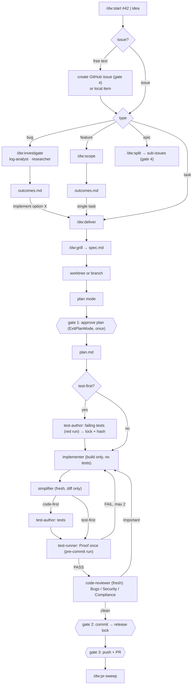

# dw — Dev Workflow plugin for Claude Code

A Claude Code plugin that takes a GitHub issue (or just an idea) through design, plan, tests, implementation, review, commit and pull request, with hard guardrails at every step that matters. It works with any language or stack.

Principles:
- **Artifact chain.** spec (issue + decisions) → plan → diff → PR. Each stage writes one artifact that the next stage reads.
- **Small orchestrator.** The main session stays small; the heavy work runs in subagents with strict output contracts.
- **Hooks for rules.** Deterministic rules live in hooks, including the four approval gates, not in prose the model may forget.
- **Skills for know-how.**
- **Repo facts stay in the repo.** Commands, test conventions and review rules live in the repo's `CLAUDE.md`, `REVIEW.md` and `.claude/dw.json`.

The repo is a git repo and its own single-plugin marketplace.

## Install
Requirements:
- Claude Code (recent; plugin `userConfig` support)
- `node` (hooks and scripts use only Node built-ins, no `npm install`)
- `git`
- `gh`, authenticated (`gh auth login`), for issues and pull requests. `gh stack` is optional (stacked PRs).
- Optional: the GitHub MCP server. Its tools are gated the same way as `gh` (see Gates).

```text
# in Claude Code, from a local clone:
/plugin marketplace add /path/to/dw
# or straight from GitHub:
/plugin marketplace add <owner>/dw
/plugin install dw@dw
/reload-plugins
```

When you enable the plugin, it asks for these options. Change them later with `/config`.

| Option | Default | Meaning |
|---|---|---|
| `research_root` | *(empty)* | Folder for per-item folders (`<id>-<slug>`). Empty means `<parent of main checkout>/<family>-research`, where family is the checkout folder name up to the first `.` (`my-app` and `my-app.web` share `my-app-research`). It must be outside the main checkout: Claude Code blocks edits to the main checkout from a worktree session. |
| `protected_branches` | `main,master,develop,release/*` | Edit/Write is blocked on these branches, except for git-ignored files. |
| `branch_template` | `{prefix}/{id}-{slug}` | Item branch name. `prefix` is `fix` for a bug, else `feature` (`fix/42-null-ref`, `feature/local-3-dark-mode`). |
| `worktree_root` | *(empty)* | Where item worktrees go. Empty means `<parent of main checkout>/<repo>-worktrees`. |
| `github_mcp_servers` | `github` | MCP servers treated as GitHub for gates 3 and 4 (exact name, or a plugin server ending in `_<name>`). |
| `type_labels` | `bug=bug;epic=epic;feature=enhancement\|feature;task=task` | Which issue labels mean which item type (personal repos have no GitHub issue types, so labels are used). No match: `/dw:start` asks. |
| `usage_auto_refresh` | `true` | Refresh `usage.md`/`usage.json` and the usage dashboard at session end and `/clear` (reads local transcripts only, no tokens). |

### First run in a repo
Run `/dw:setup-repo` once per repo (`/dw:start` offers it when the repo has none). It reads the repo (manifests, lockfiles, CI workflows, README, `CLAUDE.md`), proposes the build/test/lint/format commands and the test-file rules, and writes `.claude/dw.json` after you approve. Commit that file. Optionally paste `templates/repo/CLAUDE.additions.md` and `templates/repo/REVIEW.additions.md` into the repo and fill in the `FILL-IN` lines.

### Updating
After pulling a new version (or merging a change to your local clone):
```
/plugin marketplace update dw
/plugin update dw@dw
/reload-plugins
```
Restart the session if hooks or skills do not appear to change. When you change behaviour yourself, bump `version` in both manifests (`.claude-plugin/plugin.json`, `.claude-plugin/marketplace.json`), or the update sees nothing new.

## Workflow


| Stage | Reads | Writes |
|---|---|---|
| start | GitHub issue (or your words) | `spec.md` (`## Source`) |
| investigate / scope / split | spec.md Source | `outcomes.md`, `documents/`, `split-draft.md` |
| grill | spec.md Source, outcomes.md, researcher facts | `spec.md` (`## Decisions`) |
| plan | spec.md | `plan.md` (frontmatter = run state) |
| tests → implement → simplify → verify → review | plan.md (+spec, REVIEW.md, repo profile) | diff, locked tests, short contracts |
| commit / PR | plan.md, test + review results | commit, PR, `history.md` (iteration ledger) |

### Items: GitHub issues or local
- `/dw:start 42`, `/dw:start #42` or an issue URL reads the issue with `gh` and routes by its type label.
- `/dw:start add dark mode` (free text) asks once: **create a GitHub issue** (drafted for you, created behind gate 4) or **local item, no issue** (`local-3`). A local item gets the same spec, plan, gates and locks; its commits and PR just carry no issue reference.
- Item folders are `<research_root>/<id>-<slug>` (`42-dark-mode`, `local-3-dark-mode`).
- Commits end with `(#42)`; the PR body starts with `Closes #42`, so GitHub links and closes the issue. No issue comments are posted unless you ask.

## Commands
| Command | What it does |
|---|---|
| `/dw:start <#n\|url\|idea>` | Reads the issue (or creates one / a local item), creates the item folder and `spec.md` (Source), and routes by type, then continues into the next skill itself (a task asks one yes/no approval first). |
| `/dw:investigate <id>` | Downloads issue attachments, runs analysis in subagents, writes `outcomes.md` with root cause and fix options. No code changes, no issue writes. |
| `/dw:scope <id>` | Scopes a feature, judges its size, and offers deliver, a split into sub-issues, or a design note. |
| `/dw:split <id>` | Drafts sub-issues, gets your approval, creates them and links them to the parent (gate 4). |
| `/dw:grill [target]` | Design interview whose decisions go into `spec.md`. Also usable on any idea. |
| `/dw:deliver <id> [option X]` | The full delivery pipeline. On an item already `done` it starts the next iteration (old plan archived, `history.md` updated). |
| `/dw:resume <id>` | Continues an item in a new session from `plan.md`'s phase. |
| `/dw:status` | Shows phase, worktree, test lock, fix cycles and PR. |
| `/dw:commit` | Scoped commit for the item (gate 2). |
| `/dw:pr [--draft] [--stack]` | Push plus PR, or a `gh stack` of PRs (gate 3). |
| `/dw:pr-sweep [n]` | One cycle over unresolved review threads and failing checks: fix, test once, push, reply. |
| `/dw:setup-repo [path]` | Infers the repo profile and writes `.claude/dw.json` after approval. |
| `/dw:usage [id]` | Tokens and estimated $ per item (main session + subagents) broken down by stages and areas (from changed files, filterable on the dashboard), with threshold signals, written to `<item>/usage.md` + `usage.json`, plus `<research_root>/usage-dashboard.html` and `usage-help.html`. Config lives in `scripts/usage-config.json` (overridable in `<research_root>/usage-config.local.json`), refreshes automatically at session end (`usage_auto_refresh`), and marks an item merged once its PR in `plan.md` is merged. |
| `/dw:unlock-tests <reason>` | Removes the test lock of the current checkout (asks you first). The reason is logged in `plan.md`. |

Knowledge skills that Claude loads by itself: `worktree`, `github-conventions`.

## Agents
| Agent | Model | May edit | Returns |
|---|---|---|---|
| researcher | sonnet | – | cited facts (code, issues via read-only `gh`) |
| complexity-estimator | haiku | – | size class + ambiguity flags as JSON (`estimate.json`, used by `/dw:usage`) |
| log-analyst | sonnet | `documents/log-analysis.md` | timeline, anomalies, suspect code from logs/OTEL traces |
| test-author | sonnet | test files only | tests and their fail/pass reason |
| implementer | inherit | production code only, no test runs | files changed, build, deviations |
| simplifier | sonnet | only files already in the diff, no tests | edits, LOC delta |
| test-runner | sonnet | – | pass/fail plus root-cause notes |
| code-reviewer | inherit | – | findings by pass and severity |

## Stacks: profiles, presets and `/dw:setup-repo`
dw's core knows no language. Hooks and agents only use a **repo profile**:

| Field | Used by |
|---|---|
| `test_globs`, `test_command_pattern` | hooks: which files are tests (test lock, who may edit them) and which commands run tests (blocked for implementer/simplifier) |
| `build_cmd`, `test_cmd`, `test_filter_hint`, `lint_cmd`, `format_cmd` | implementer, simplifier, test-author, test-runner |
| `base_branch`, `gh_repo` | worktree, commit, PR (defaults: `origin/HEAD` or `main`; the `origin` URL) |
| `copy_untracked` | files copied into a new worktree (e.g. `.env.local`), never committed |
| `single_command_shell` | `true` for repos whose permission rules allow only one command per Bash call (no `&&`, pipes, `git -C`) |

The profile is resolved in this order:
1. `.claude/dw.json` in the repo (committed; see `templates/repo/dw.example.json`);
2. `<research_root>/dw-repos.json`, keyed by repo name, for repos you don't want to commit to (`templates/repo/dw-repos.example.json`);
3. detected **presets** in `presets/` (v1: `node`, `dotnet`; a repo can match several);
4. a generic **fallback**: common test folders and file names, and a test-command pattern covering all known runners. It errs on the side of blocking.

Test rules can only be **added** by a profile file, never removed: an override cannot switch test protection off, and unsafe regexes are dropped with a warning (`dw-state.js profile` shows them).

**Adding a stack** needs no code: run `/dw:setup-repo` in that repo, or add one JSON file to `presets/` (`detect`, `test_globs`, `test_command_pattern`, `build_cmd`, `test_cmd`, `test_filter_hint`, `lint_cmd`, `format_cmd`) and open a PR.

## Multi-repo items
One item can change several repos (for example `api` and `web`). Which repos is decided in the plan (`## Repos`, `repos:` in the `plan.md` frontmatter), so you approve it once at gate 1. After approval `/dw:deliver` binds the other repo itself:
1. Finds its main checkout (a sibling folder whose `origin` matches, otherwise asks for the path).
2. Asks the worktree-or-branch question for it, with the same branch name, and copies the profile's `copy_untracked` files.
3. Runs `dw-state.js bind-repo`.

From then on every stage runs once per repo that has changes, with that repo's own profile; commits and PRs are per repo and cross-linked (`prs:` in `plan.md`). `dw-state.js repos` prints every bound repo with its effective profile. Test locks are per checkout; `verify-locks` and `release-locks` cover every bound repo. The edit guard refuses any repo not bound to the item.

Limits: no cross-repo merge ordering and no `gh stack` spanning repos.

## Gates
| Gate | What asks | Why |
|---|---|---|
| 1 plan | `ExitPlanMode` approval (recorded once by a hook); `set-phase approved` without it; phase jumps out of pre-approval | no code before you approve the plan |
| 2 commit | `git commit`, `merge`, `cherry-pick`, `revert`, `pull` without `--ff-only` | you see what is committed |
| 3 code on GitHub | `git push`, `gh pr`/`stack`/`release`/`repo`/`workflow` writes, other `gh api` writes, GitHub MCP PR/repo writes | nothing leaves your machine unasked |
| 4 tracker | `gh issue`/`label`/`project item` writes, `gh api` writes to `/issues`, `/labels`, `/milestones`, sub-issues, issue GraphQL mutations, GitHub MCP issue writes | issues are the source of truth |
| discards | `reset --hard`, `restore`, `clean -f`, `stash drop`, `branch -D`, `rebase`, `worktree remove --force`, forced `switch`/`checkout` | they lose work |

## Review triage
The code-reviewer is a fresh model, so it can be wrong or over-reach, and each cheap-looking fix grows the diff. Before any fix, the orchestrator checks every Important finding at its cited `path:line` and records an outcome in a ledger: `fix`, `disagree` (with evidence) or `decline` (out of scope or a nit, listed as a follow-up). Security findings, and findings on any topic under `## Never dismiss` in the repo's `REVIEW.md`, are never dismissed without you. The implementer gets only the `fix` items and is told to make the smallest change; `git diff --shortstat` is checked before and after, and the ledger goes to the single re-review.

## When tests run
Tests run at two points, not after every code change:
1. **Red step** (test-first only): test-author runs the new tests once and they must FAIL for the expected reason. They are then locked (path + SHA-256).
2. **Before the commit**: test-runner runs the plan's Proof once (and once per fix batch, max 2 fix cycles).

Implementer and simplifier only build (or type-check). Locked tests are their spec; a hash check after each subagent (SubagentStop for its own checkout, `verify-locks` for every bound repo) and at the commit gate makes sure they were not changed by any route. After the commit the lock is released, so PR-review test changes go through test-author normally.

Considered and rejected: letting the implementer run the locked tests while coding. Each FAIL would then cost a fresh implementer spawn plus a test-runner run; revisit if fix cycles become frequent.

## Hooks (`hooks/hooks.json`, node, no npm dependencies)
| Hook | Rule |
|---|---|
| `guard-edit.js` (Edit/Write/NotebookEdit) | **Deny:** edits on protected branches (git-ignored files allowed); outside the active item's worktree (checkouts bound with `bind-repo` count as inside); code edits before `phase: approved` (fails closed); plan.md phase edits that skip gate 1; locked tests (anyone); tests by implementer/simplifier; production code by test-author; files outside the diff by simplifier; anything inside `.git`. **Ask:** edits to `.claude/dw.json`. |
| `gate-bash.js` (Bash/PowerShell) | **Ask:** gates 1-4 and discards (table above), test unlock, `dw-state.js clear`. Looks inside `bash -c`, `pwsh -Command`/`-EncodedCommand`, `cmd /c` and `eval`. **Deny:** test commands for implementer/simplifier; `git commit` while a locked test differs from its locked hash; shell writes to `<git-dir>/dw/` state. |
| `gate-mcp.js` (GitHub MCP tools) | Known read verbs → allow; writes → ask (issue tools gate 4, PR/repo tools gate 3); anything unknown → ask. |
| `plan-approved.js` (PostToolUse `ExitPlanMode`) | Records the plan-mode approval as gate 1, so the plan is approved once. |
| `subagent-stop.js` (SubagentStop) | If a locked test changed during the subagent's run, sends it back once to report `LOCKED TEST CHANGED`. |
| `session-start.js` | Titles the session with the worktree branch and announces an active item (and its bound repos). |
| `usage-refresh.js` (SessionEnd) | Refreshes the bound item's usage stats and the dashboard when `usage_auto_refresh` is on. No tokens used. |
| `allow-item-dir.js` (Read/Grep/Glob/Edit/Write) | **Allows** access to the bound item's folder from a worktree, so subagents use the single copy in place without an outside-directory prompt. Only allows; `guard-edit.js` denies still win. |

Every block or ask explains why and how to proceed. Hooks never rewrite commands.

**Known limits**
- A shell command can still write production files outside the Edit guard (e.g. code edits before approval via `sed -i`). Locked tests are covered by the hash check, dw state by the shell-write deny; the rest relies on the agents' tool lists and the reviewer's diff check.
- Wrapper coverage is text matching, so it is partial. Looked into: `bash`/`sh`/`zsh -c`, `pwsh`/`powershell -Command` and `-EncodedCommand`, `cmd /c`, `eval`. **Not** looked into, so these pass silently:
  - script files: `pwsh -File script.ps1`, `bash script.sh`, `node script.js`;
  - inline code in other interpreters: `node -e "execSync('git push')"`, `python3 -c "subprocess.run(['git','push'])"`;
  - git aliases: `git -c alias.ship=push ship` (and aliases from your git config).
  Gates hold against an agent following the skills, not against one deliberately evading them; the reviewer and your own diff/PR review are the backstop.
- Test-command detection is a regex over the command text. A runner that no profile, preset or fallback pattern knows is not blocked for the implementer: add it with `/dw:setup-repo`.
- A hook's `ask` cannot prompt when there's no one to answer (`-p` / `dontAsk`). In that case the action does not run.

## Using `/goal` and `/loop` (optional)
`/goal <condition>` keeps Claude working, turn after turn, until a small model judges that the condition is met. It does **not** change permissions: dw gates still ask, and in `-p`/`dontAsk` an ask means the action doesn't happen. So `/goal` fits stretches *between* gates. Two recipes:
- **PR babysitting:** `/goal PR 812 has no unresolved review threads and all checks are green, or 6 /dw:pr-sweep cycles have run, or a sweep needs my decision`.
- **Approved plan to commit gate:** after gate 1, `/goal /dw:deliver for #123 reaches phase commit, or it escalates (fix cycles > 2 or blocked)`.

Plain `/loop` also works for the sweep, for example `/loop 30m /dw:pr-sweep`.

## Resume in a new session
- Start Claude inside the worktree. The SessionStart hook titles the session and says which item the worktree belongs to.
- Or, from anywhere in the repo, run `/dw:resume <id>`. It finds the worktree (`dw-state.js find`), enters it, reads `plan.md`'s phase, and continues.

Run state lives in two places:
- `plan.md` frontmatter: `item_id`, `tracker`, `type`, `phase`, `test_mode`, `fix_cycles`, `pr`, `repos`, `prs`.
- `<git-dir>/dw/`: the item binding, the test lock (hashes ignore CRLF/LF and a BOM) and the recorded plan approval (a hash of the approved plan, compared with plan.md at `set-phase approved`).

## Cleanup and the archive
Cleaning up an item (after merge, or whenever you ask to remove its worktree/branch) runs `dw-state.js clear`, the worktree removal, and then `dw-state.js archive --id <id>`, which moves the item folder to `<research_root>/archive/<id>-<slug>`. To pick the item up again, move the folder back to `<research_root>/` yourself; until you do, `item-path` (and so `/dw:start`) refuses that id instead of creating a second folder. Archived items stay on the usage dashboard.

## Develop
```text
npm test                        # hook + dw-state unit tests (node --test)
claude plugin validate . --strict
claude plugin eval . --trust-plugin --scaffold --allow-tools Bash Edit Write Agent --ablation none --no-publish -j 3   # see evals/README.md
```
Same test policy as the plugin itself: write the failing test first and run it once (red), then run the suite once before committing. `npm run setup` installs a pre-commit hook (`.githooks/pre-commit`) that runs `npm test`.

Contributions welcome, especially new presets. See `CHANGELOG.md` for changes.

## License
MIT, see [LICENSE](LICENSE).
